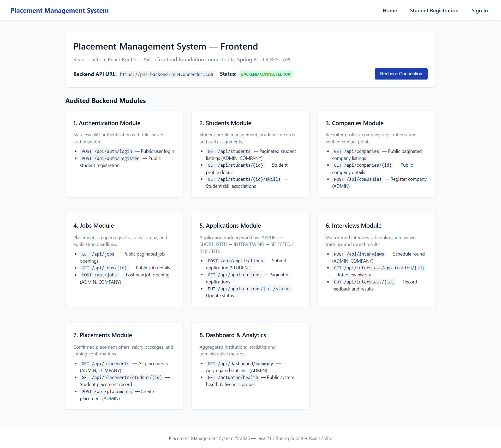
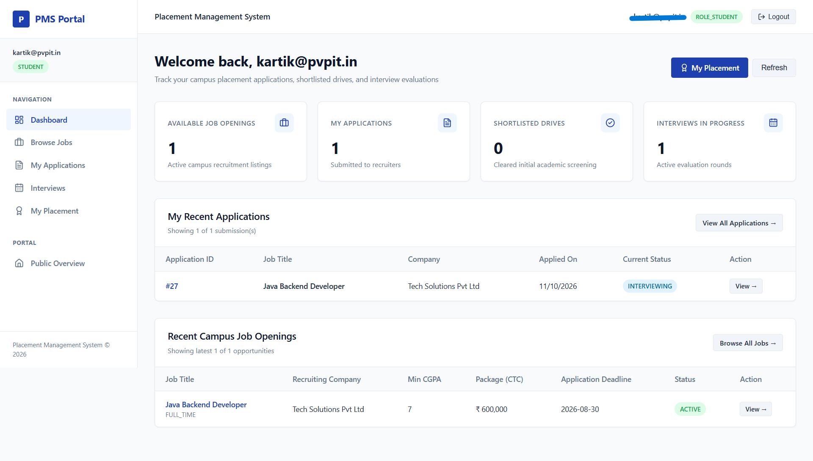
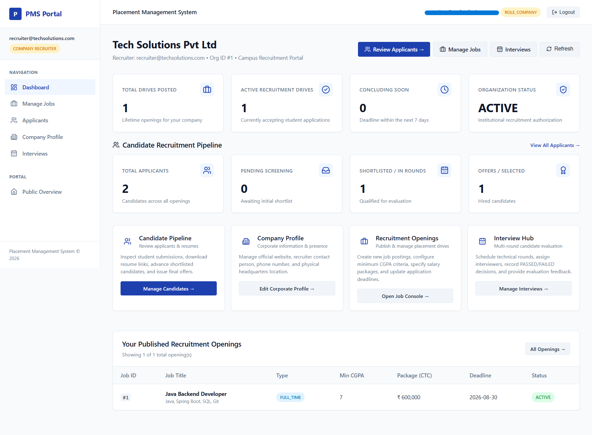
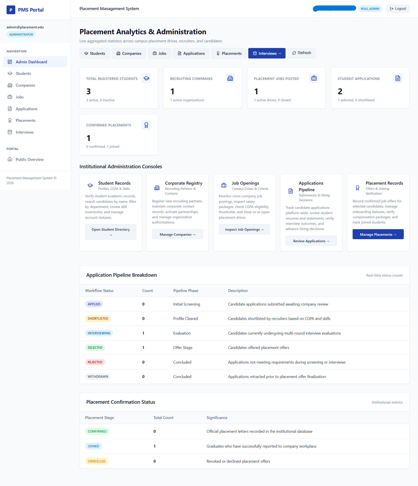

# Placement Management System

A full-stack web application for managing campus placements in one place. It connects students, recruiters and placement administrators through a role-based portal.

**[Live Application](https://placement-management-system.pages.dev/)** · **[Backend Health](https://pms-backend-2eu4.onrender.com/actuator/health)**

## Screenshots

### Public Home Page


### Student Dashboard


### Recruiter Dashboard


### Admin Dashboard


## Features

### Student
- Register and manage a student profile.
- Browse available jobs and submit applications.
- Track application progress and interview rounds.
- View placement information.

### Recruiter
- Manage company information and job openings.
- Review applications for the recruiter's company.
- Shortlist candidates and schedule interviews.
- Record interview feedback and results.

### Administrator
- Manage student and company records.
- Oversee job openings and applications.
- Create and manage placement records.
- View placement and recruitment statistics.

## Technology Stack

| Area | Technologies |
|---|---|
| Backend | Java 21, Spring Boot 4 |
| Security | Spring Security, JWT |
| Frontend | React, JavaScript, Vite |
| Persistence | Spring Data JPA |
| Database | MySQL / TiDB Cloud |
| Build | Maven |
| Testing | JUnit, Mockito |
| DevOps | Docker, GitHub Actions |
| Hosting | Render, Cloudflare Pages |

## Architecture

```text
React + Vite
    |
    | HTTPS / REST API
    v
Spring Boot REST API
    |
    v
Spring Data JPA
    |
    v
TiDB Cloud (MySQL-compatible)
```

## Run Locally

### Prerequisites
- Java 21
- MySQL
- Node.js and npm

### 1. Clone the repository

```bash
git clone https://github.com/Kartik-7813/placement-management-system.git
cd placement-management-system
```

### 2. Configure and start the backend

Create a local MySQL database named `placement_management_system`. Configure the database connection and a Base64-encoded JWT secret through environment variables. Do not commit credentials or secrets.

On Windows PowerShell:

```powershell
$env:SPRING_DATASOURCE_URL = "jdbc:mysql://localhost:3306/placement_management_system"
$env:SPRING_DATASOURCE_USERNAME = "root"
$env:SPRING_DATASOURCE_PASSWORD = "<your-local-mysql-password>"
$env:JWT_SECRET = "<your-base64-encoded-256-bit-secret>"

.\mvnw.cmd spring-boot:run
```

The backend starts on `http://localhost:8080` by default.

### 3. Configure and start the frontend

Open another terminal:

```bash
cd frontend
npm install
```

Create `frontend/.env` using `frontend/.env.example` as a reference:

```env
VITE_API_BASE_URL=http://localhost:8080
```

Start the frontend:

```bash
npm run dev
```

Open the local URL printed by Vite in your terminal.

## Live Deployment

| Component | Platform |
|---|---|
| Frontend | [Cloudflare Pages](https://placement-management-system.pages.dev/) |
| Backend API | [Render](https://pms-backend-2eu4.onrender.com/) |
| Database | TiDB Cloud |

The Render free service may take some time to respond after a period of inactivity.

---

Built as a full-stack software engineering project.