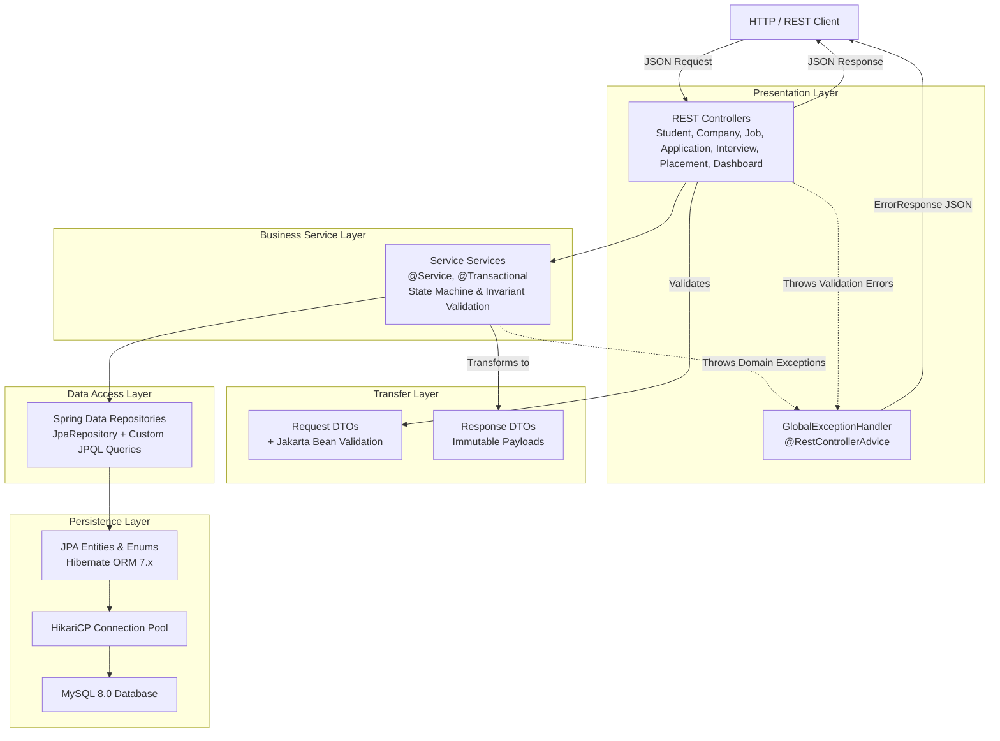
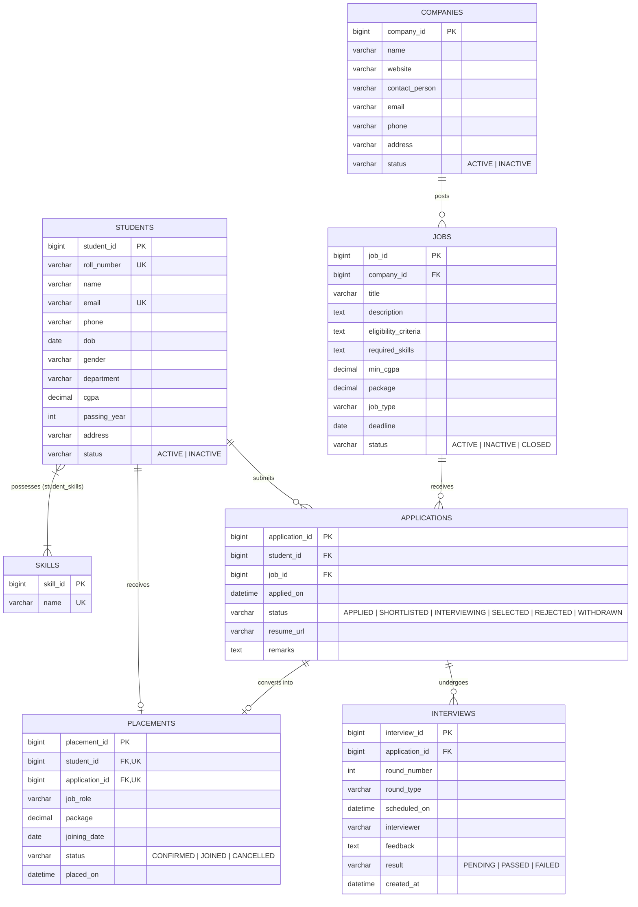

# Placement Management System (PMS)

A robust, enterprise-grade RESTful backend application built with **Java 21**, **Spring Boot 4**, **Spring Data JPA**, and **MySQL**. Engineered to automate and streamline campus placement drive operations, this system coordinates student registrations, skill profiling, company recruitment drives, multi-round interview workflows, eligibility enforcement, and final offer tracking with aggregate institutional metrics.

---

## Table of Contents

- [Overview & Objectives](#overview--objectives)
- [Key Features & Modules](#key-features--modules)
- [Technology Stack](#technology-stack)
- [System Architecture](#system-architecture)
- [Database & Entity Relationship Model](#database--entity-relationship-model)
- [Architectural Layers](#architectural-layers)
- [Implemented Business Workflows & Validation Rules](#implemented-business-workflows--validation-rules)
- [API Reference](#api-reference)
- [Sample Request & Response Payloads](#sample-request--response-payloads)
- [Error Handling & Status Codes](#error-handling--status-codes)
- [Automated Testing & Verification](#automated-testing--verification)
- [Local Setup & Configuration Guide](#local-setup--configuration-guide)
- [Security & Deployment Status](#security--deployment-status)
- [Known Limitations](#known-limitations)
- [Future Enhancements (Planned)](#future-enhancements-planned)
- [Technical Competency & Conclusion](#technical-competency--conclusion)

---

## Overview & Objectives

### Problem Statement
Campus placement drives involve complex coordination among hundreds of students, visiting recruiters, and placement coordinators. Traditional methods relying on spreadsheets and ad-hoc communication suffer from:
- Inconsistent tracking of student application statuses across multiple recruitment rounds.
- Manual verification overhead for academic prerequisites (e.g., minimum CGPA thresholds and drive deadlines).
- Risk of duplicate applications or awarding multiple concurrent job placements to a single student without administrative policy checks.
- Lack of centralized, real-time analytics on departmental placement ratios and company participation.

### Solution & Core Objectives
The **Placement Management System (PMS)** provides a centralized REST API backend that:
1. **Enforces Institutional Integrity**: Applies server-side business rules for academic eligibility, drive deadlines, student/company active status, and one-placement-per-student invariants.
2. **Standardizes Multi-Stage Workflows**: Implements a deterministic state machine for job applications (`APPLIED` &rarr; `SHORTLISTED` &rarr; `INTERVIEWING` &rarr; `SELECTED` / `REJECTED` / `WITHDRAWN`) and interview evaluations.
3. **Ensures Data Isolation & Validation**: Separates external client schemas from database persistence models using Data Transfer Objects (DTOs) with declarative Jakarta Bean Validations.
4. **Delivers Operational Intelligence**: Exposes a real-time summary dashboard aggregating metrics across students, companies, job listings, applications, and verified placements.

---

## Key Features & Modules

### 1. Student Management Module
- Register student profiles with academic attributes (roll number, department, CGPA, passing year, contact info).
- Enforces uniqueness constraints on `rollNumber` and `email`.
- Dynamic search and filter by student name, academic department, and enrollment status with Spring Data pagination and sorting.
- Soft deactivation preserving historical placement audit trails.
- Many-to-many skill tagging allowing students to attach technical competencies.

### 2. Company & Corporate Partner Module
- Onboard corporate recruitment partners with domain, contact person, website, and industry details.
- Status management (`ACTIVE`, `INACTIVE`) to govern hiring privileges.
- Filter and search companies by name and status.

### 3. Job Drive Management Module
- Create and manage campus recruitment drives tied to registered companies.
- Specify hiring parameters: compensation package, job role/type, job description, required skills, minimum CGPA eligibility, and application cut-off deadlines.
- Status lifecycle: `ACTIVE`, `INACTIVE`, and `CLOSED`.
- Prevents job creation under inactive corporate accounts.

### 4. Application Processing Module
- Validates student eligibility before application persistence (active enrollment check, active job check, CGPA cutoff comparison, and deadline compliance).
- Prevents duplicate applications via composite uniqueness checks (`student_id` + `job_id`).
- Governed status transitions preventing illegal lifecycle skips (e.g., moving directly from `APPLIED` to terminal `SELECTED`).

### 5. Interview Evaluation Module
- Schedule multi-round interviews (`scheduledOn`, `roundNumber`, `roundType`, `interviewer`) exclusively for shortlisted candidates.
- Automatically transitions the parent application to `INTERVIEWING` upon first round scheduling.
- Eliminates duplicate rounds for the same application.
- Evaluates round outcomes (`PENDING`, `PASSED`, `FAILED`) with detailed evaluator feedback.

### 6. Placement & Offer Management Module
- Issues formal placement records exclusively for candidates with `SELECTED` application status.
- Validates student-application integrity and enforces strict single-placement rules per student.
- Lifecycle tracking for job offers: `CONFIRMED` &rarr; `JOINED` or `CANCELLED`.

### 7. Administrative Analytics Dashboard
- Single-endpoint aggregate overview displaying counts for:
  - Active vs. inactive students.
  - Active vs. inactive corporate partners.
  - Active vs. closed campus job openings.
  - Applications by status breakdown (`APPLIED`, `SHORTLISTED`, `INTERVIEWING`, `SELECTED`, `REJECTED`, `WITHDRAWN`).
  - Placements by status breakdown (`CONFIRMED`, `JOINED`, `CANCELLED`).

---

## Technology Stack

| Layer / Component | Technology | Version | Purpose |
| :--- | :--- | :--- | :--- |
| **Language** | Java (JDK) | **21 LTS** (tested on 21.0.9) | Core language runtime leveraging modern syntax and records |
| **Framework** | Spring Boot | **4.0.7** | Application scaffolding, dependency injection, and autoconfiguration |
| **Web MVC** | Spring Web MVC | **4.0.7** | DispatcherServlet, RESTful controllers, content negotiation |
| **ORM / Persistence** | Hibernate Core | **7.2.19.Final** | Object-Relational Mapping (JPA 3.2 implementation) |
| **Data Access** | Spring Data JPA | **4.0.7** | Repository abstractions, derived queries, dynamic JPQL |
| **Database** | MySQL | **8.0.46** | Relational data persistence and constraint enforcement |
| **JDBC Driver** | MySQL Connector/J | **9.x** (`com.mysql:mysql-connector-j`) | Database connectivity |
| **Connection Pool** | HikariCP | Bundled | Production-grade JDBC connection pooling |
| **Validation** | Jakarta Bean Validation | Bundled (`Hibernate Validator`) | Declarative payload constraint validation |
| **Build Tool** | Apache Maven | Wrapper (`./mvnw`, `mvnw.cmd`) | Build lifecycle, dependency management, test execution |
| **Testing** | JUnit 5 & Spring Boot Test | Bundled | Unit, application context, and slice testing |

---

## System Architecture

The application adopts a clean, layered architectural pattern adhering to separation of concerns and standard Spring Boot conventions:



---

## Database & Entity Relationship Model

The relational schema is mapped across 7 domain entities and 1 join table with strict foreign key constraints and uniqueness rules.



### Relational Invariants & Table Details
- **`students`**: Unique constraints on `roll_number` and `email`.
- **`applications`**: Unique composite constraint `uk_student_job` (`student_id`, `job_id`) guaranteeing a student can apply to a specific job opening only once.
- **`placements`**: Unique constraints on both `student_id` and `application_id` enforcing that a student holds at most one confirmed placement offer and an application can only yield one placement record.
- **`student_skills`**: Join table managing the many-to-many relationship between `students` and `skills`.

---

## Architectural Layers

### 1. Controller Layer (`com.placementmanagementsystem.controller`)
- Exposes RESTful endpoints mapped under `/api/*`.
- Triggers bean validation on incoming payloads using `@Valid`.
- Accepts query parameters for pagination, multi-field sorting, and filtering (`@PageableDefault`).
- Returns standardized `ResponseEntity<T>` with accurate HTTP status codes (`200 OK`, `201 Created`, `204 No Content`).

### 2. Service Layer (`com.placementmanagementsystem.service`)
- Decorated with `@Service` and `@Transactional` (with `@Transactional(readOnly = true)` for query optimization).
- Manages business invariants: eligibility evaluation, duplicate checks, workflow state machine transitions, and soft-delete states.
- Performs bidirectional conversion between JPA entities and DTO contracts.

### 3. Repository Layer (`com.placementmanagementsystem.repository`)
- Extends `JpaRepository<Entity, Long>` for out-of-the-box CRUD and pagination.
- Includes custom derived query methods (e.g., `countByStatus`, `existsByStudent_StudentId`).
- Defines optimized JPQL queries via `@Query` with parameter bindings (`@Param`) for composite filtering with nullable search parameters.

### 4. DTO (Data Transfer Object) Layer (`com.placementmanagementsystem.dto`)
- Decouples domain entities from external clients, preventing over-posting and Jackson circular reference loops.
- Employs Jakarta Validation annotations (`@NotBlank`, `@NotNull`, `@Email`, `@DecimalMin`, `@DecimalMax`, `@PositiveOrZero`).

### 5. Exception Handling Layer (`com.placementmanagementsystem.exception`)
- Centralized `@RestControllerAdvice` converting unchecked domain exceptions into structured `ErrorResponse` payloads.

---

## Implemented Business Workflows & Validation Rules

### 1. Job Application Submission Workflow
When `POST /api/applications` is called, `ApplicationService` enforces seven consecutive checks:
1. **Student Existence**: Resolves `studentId`; throws `StudentNotFoundException` (404) if absent.
2. **Student Activity**: Verifies student `status == ACTIVE`; throws `InactiveStudentException` (400) if inactive.
3. **Job Existence**: Resolves `jobId`; throws `JobNotFoundException` (404) if absent.
4. **Job Status Check**: Verifies job `status == ACTIVE`; throws `JobNotAcceptingApplicationsException` (400) if closed/inactive.
5. **Deadline Verification**: Compares `LocalDate.now()` against `job.getDeadline()`; throws `ApplicationDeadlinePassedException` (400) if expired.
6. **Academic Eligibility (CGPA)**: Verifies student has a recorded CGPA and that `student.getCgpa() >= job.getMinCgpa()`; throws `StudentNotEligibleException` (400) if below threshold.
7. **Duplicate Prevention**: Checks existing applications for the student and job combination; throws `ApplicationAlreadyExistsException` (409) if an entry already exists.

### 2. Application Status State Machine
Status updates via `PUT /api/applications/{id}/status?status={status}` follow a controlled transition model:

```
  +---------+
  | APPLIED |
  +----+----+
       |
       +------------+-----------------------+
       |            |                       |
       v            v                       v
+--------------+ +----------+         +-----------+
| SHORTLISTED  | | REJECTED |         | WITHDRAWN |
+------+-------+ +----------+         +-----------+
       |
       +------------+-----------------------+
       |            |                       |
       v            v                       v
+--------------+ +----------+         +-----------+
| INTERVIEWING | | REJECTED |         | WITHDRAWN |
+------+-------+ +----------+         +-----------+
       |
       +------------+
       |            |
       v            v
+----------+   +----------+
| SELECTED |   | REJECTED |
+----------+   +----------+
```

- **Terminal States**: `SELECTED`, `REJECTED`, and `WITHDRAWN` cannot transition to any other status. Attempting illegal transitions throws `IllegalStateException` (400).

### 3. Interview Scheduling & Progression
- An interview can only be scheduled for an application whose status is either `SHORTLISTED` or `INTERVIEWING`.
- Scheduling the first interview round automatically promotes a `SHORTLISTED` application to `INTERVIEWING`.
- Duplicate round numbers for the same application are blocked with `InterviewAlreadyExistsException` (409).

### 4. Placement Confirmation Workflow
When `POST /api/placements` is called:
1. Validates that the student and application exist in the database.
2. Asserts that the application belongs to the specified student (`PlacementStudentMismatchException` &rarr; 400).
3. Asserts that the application status is `SELECTED` (`ApplicationNotSelectedException` &rarr; 400).
4. Verifies the student has no existing placement records (`PlacementAlreadyExistsException` &rarr; 409).
5. Sets initial placement status to `CONFIRMED`.
6. Placement status progression: `CONFIRMED` can move to `JOINED` or `CANCELLED`. Both `JOINED` and `CANCELLED` are terminal.

---

## API Reference

Base path for all endpoints: `/api`

### 1. Student Endpoints (`/api/students`)
| Method | Endpoint | Query Parameters | Request Body | Status Code | Description |
| :--- | :--- | :--- | :--- | :--- | :--- |
| `POST` | `/api/students` | None | `StudentRequest` | `201 Created` | Create new student record |
| `GET` | `/api/students` | `department`, `status`, `name`, `page`, `size`, `sort` | None | `200 OK` | Get paginated, filtered students |
| `GET` | `/api/students/{id}` | None | None | `200 OK` | Get student details by ID |
| `PUT` | `/api/students/{id}` | None | `StudentRequest` | `200 OK` | Update existing student record |
| `DELETE` | `/api/students/{id}` | None | None | `204 No Content` | Soft deactivate student (`status = INACTIVE`) |
| `GET` | `/api/students/{studentId}/skills` | None | None | `200 OK` | Retrieve skills assigned to student |
| `POST` | `/api/students/{studentId}/skills/{skillId}` | None | None | `200 OK` | Assign skill to student |
| `DELETE` | `/api/students/{studentId}/skills/{skillId}` | None | None | `204 No Content` | Remove skill from student |

### 2. Company Endpoints (`/api/companies`)
| Method | Endpoint | Query Parameters | Request Body | Status Code | Description |
| :--- | :--- | :--- | :--- | :--- | :--- |
| `POST` | `/api/companies` | None | `CompanyRequest` | `201 Created` | Register corporate partner |
| `GET` | `/api/companies` | `name`, `status`, `page`, `size`, `sort` | None | `200 OK` | Get paginated, filtered companies |
| `GET` | `/api/companies/{id}` | None | None | `200 OK` | Get company details by ID |
| `PUT` | `/api/companies/{id}` | None | `CompanyRequest` | `200 OK` | Update company record |
| `DELETE` | `/api/companies/{id}` | None | None | `204 No Content` | Soft deactivate company (`status = INACTIVE`) |

### 3. Job Endpoints (`/api/jobs`)
| Method | Endpoint | Query Parameters | Request Body | Status Code | Description |
| :--- | :--- | :--- | :--- | :--- | :--- |
| `POST` | `/api/jobs` | None | `JobRequest` | `201 Created` | Post a job opening for an active company |
| `GET` | `/api/jobs` | `title`, `companyId`, `status`, `minCgpa`, `page`, `size`, `sort` | None | `200 OK` | Get paginated, filtered jobs |
| `GET` | `/api/jobs/{id}` | None | None | `200 OK` | Get job listing by ID |
| `PUT` | `/api/jobs/{id}` | None | `JobRequest` | `200 OK` | Update job posting attributes |
| `DELETE` | `/api/jobs/{id}` | None | None | `204 No Content` | Close job opening (`status = CLOSED`) |

### 4. Application Endpoints (`/api/applications`)
| Method | Endpoint | Query Parameters | Request Body | Status Code | Description |
| :--- | :--- | :--- | :--- | :--- | :--- |
| `POST` | `/api/applications` | None | `ApplicationRequest` | `201 Created` | Submit application with eligibility verification |
| `GET` | `/api/applications` | `studentId`, `jobId`, `status`, `page`, `size`, `sort` | None | `200 OK` | Get paginated, filtered applications |
| `GET` | `/api/applications/{id}` | None | None | `200 OK` | Get application details by ID |
| `PUT` | `/api/applications/{id}` | None | `ApplicationUpdateRequest` | `200 OK` | Update application details (`resumeUrl`, `remarks`) |
| `PUT` | `/api/applications/{id}/status` | `status` (Required Enum) | None | `200 OK` | Transition application lifecycle status |

### 5. Interview Endpoints (`/api/interviews`)
| Method | Endpoint | Query Parameters | Request Body | Status Code | Description |
| :--- | :--- | :--- | :--- | :--- | :--- |
| `POST` | `/api/interviews` | None | `InterviewRequest` | `201 Created` | Schedule an interview round for application |
| `GET` | `/api/interviews` | `applicationId`, `result`, `page`, `size`, `sort` | None | `200 OK` | Get paginated, filtered interviews |
| `GET` | `/api/interviews/{id}` | None | None | `200 OK` | Get interview round details by ID |
| `GET` | `/api/interviews/application/{applicationId}` | None | None | `200 OK` | Get all rounds for an application (ordered by round number) |
| `PUT` | `/api/interviews/{id}` | None | `InterviewRequest` | `200 OK` | Update interview details or feedback |
| `DELETE` | `/api/interviews/{id}` | None | None | `204 No Content` | Delete interview round record |

### 6. Placement Endpoints (`/api/placements`)
| Method | Endpoint | Query Parameters | Request Body | Status Code | Description |
| :--- | :--- | :--- | :--- | :--- | :--- |
| `POST` | `/api/placements` | None | `PlacementRequest` | `201 Created` | Confirm offer for a `SELECTED` application |
| `GET` | `/api/placements` | `status`, `page`, `size`, `sort` | None | `200 OK` | Get paginated, filtered placement records |
| `GET` | `/api/placements/{id}` | None | None | `200 OK` | Get placement record by ID |
| `GET` | `/api/placements/student/{studentId}` | None | None | `200 OK` | Get placement record for specific student |
| `PUT` | `/api/placements/{id}` | None | `PlacementRequest` | `200 OK` | Update role, package, or joining date |
| `PUT` | `/api/placements/{id}/status` | `status` (Required Enum) | None | `200 OK` | Transition placement status (`JOINED`, `CANCELLED`) |

### 7. Dashboard Endpoints (`/api/dashboard`)
| Method | Endpoint | Query Parameters | Request Body | Status Code | Description |
| :--- | :--- | :--- | :--- | :--- | :--- |
| `GET` | `/api/dashboard/summary` | None | None | `200 OK` | Retrieve aggregated placement cell metrics |

---

## Sample Request & Response Payloads

### 1. Register Student (`POST /api/students`)
**Request Body**:
```json
{
  "rollNumber": "CS2026001",
  "name": "Jane Doe",
  "email": "jane.doe@example.com",
  "phone": "+91-9876543210",
  "dob": "2003-05-15",
  "gender": "Female",
  "department": "Computer Science",
  "cgpa": 8.75,
  "passingYear": 2026,
  "address": "42 Tech Boulevard, Bangalore",
  "status": "ACTIVE"
}
```
**Response Body (`201 Created`)**:
```json
{
  "studentId": 1,
  "rollNumber": "CS2026001",
  "name": "Jane Doe",
  "email": "jane.doe@example.com",
  "phone": "+91-9876543210",
  "dob": "2003-05-15",
  "gender": "Female",
  "department": "Computer Science",
  "cgpa": 8.75,
  "passingYear": 2026,
  "address": "42 Tech Boulevard, Bangalore",
  "status": "ACTIVE"
}
```

---

### 2. Post a Job Drive (`POST /api/jobs`)
**Request Body**:
```json
{
  "companyId": 1,
  "title": "Software Development Engineer - Backend",
  "description": "Designing high-scale Java Spring Boot microservices.",
  "eligibilityCriteria": "B.Tech Computer Science or IT with >= 7.5 CGPA and no backlogs.",
  "requiredSkills": "Java, Spring Boot, MySQL, REST APIs",
  "minCgpa": 7.50,
  "packageAmount": 1400000.00,
  "jobType": "Full-Time",
  "deadline": "2026-11-30",
  "status": "ACTIVE"
}
```
**Response Body (`201 Created`)**:
```json
{
  "jobId": 1,
  "companyId": 1,
  "companyName": "Acme Technologies Corp",
  "title": "Software Development Engineer - Backend",
  "description": "Designing high-scale Java Spring Boot microservices.",
  "eligibilityCriteria": "B.Tech Computer Science or IT with >= 7.5 CGPA and no backlogs.",
  "requiredSkills": "Java, Spring Boot, MySQL, REST APIs",
  "minCgpa": 7.50,
  "packageAmount": 1400000.00,
  "jobType": "Full-Time",
  "deadline": "2026-11-30",
  "status": "ACTIVE"
}
```

---

### 3. Submit Application (`POST /api/applications`)
**Request Body**:
```json
{
  "studentId": 1,
  "jobId": 1,
  "resumeUrl": "https://storage.example.com/resumes/CS2026001-JaneDoe.pdf",
  "remarks": "Strong Java backend and database foundations."
}
```
**Response Body (`201 Created`)**:
```json
{
  "applicationId": 1,
  "studentId": 1,
  "studentName": "Jane Doe",
  "jobId": 1,
  "jobTitle": "Software Development Engineer - Backend",
  "companyName": "Acme Technologies Corp",
  "appliedOn": "2026-10-27T16:45:00",
  "status": "APPLIED",
  "resumeUrl": "https://storage.example.com/resumes/CS2026001-JaneDoe.pdf",
  "remarks": "Strong Java backend and database foundations."
}
```

---

### 4. Schedule Interview Round (`POST /api/interviews`)
**Request Body**:
```json
{
  "applicationId": 1,
  "roundNumber": 1,
  "roundType": "Technical Coding & Data Structures",
  "scheduledOn": "2026-11-05T10:00:00",
  "interviewer": "Engineering Lead - Core Platform",
  "feedback": "Pending assessment.",
  "result": "PENDING"
}
```
**Response Body (`201 Created`)**:
```json
{
  "interviewId": 1,
  "applicationId": 1,
  "roundNumber": 1,
  "roundType": "Technical Coding & Data Structures",
  "scheduledOn": "2026-11-05T10:00:00",
  "interviewer": "Engineering Lead - Core Platform",
  "feedback": "Pending assessment.",
  "result": "PENDING",
  "createdAt": "2026-10-27T16:48:00"
}
```

---

### 5. Issue Placement Record (`POST /api/placements`)
**Request Body**:
```json
{
  "studentId": 1,
  "applicationId": 1,
  "jobRole": "Software Development Engineer - Backend",
  "packageAmount": 1400000.00,
  "joiningDate": "2026-07-01",
  "status": "CONFIRMED"
}
```
**Response Body (`201 Created`)**:
```json
{
  "placementId": 1,
  "studentId": 1,
  "studentName": "Jane Doe",
  "applicationId": 1,
  "jobRole": "Software Development Engineer - Backend",
  "packageAmount": 1400000.00,
  "joiningDate": "2026-07-01",
  "status": "CONFIRMED",
  "placedOn": "2026-10-27T17:00:00"
}
```

---

### 6. Analytics Dashboard Summary (`GET /api/dashboard/summary`)
**Response Body (`200 OK`)**:
```json
{
  "totalStudents": 150,
  "activeStudents": 142,
  "inactiveStudents": 8,
  "totalCompanies": 25,
  "activeCompanies": 22,
  "inactiveCompanies": 3,
  "totalJobs": 35,
  "activeJobs": 28,
  "closedJobs": 7,
  "totalApplications": 210,
  "appliedApplications": 65,
  "shortlistedApplications": 45,
  "interviewingApplications": 30,
  "selectedApplications": 20,
  "rejectedApplications": 40,
  "withdrawnApplications": 10,
  "totalPlacements": 20,
  "confirmedPlacements": 18,
  "joinedPlacements": 2,
  "cancelledPlacements": 0
}
```

---

## Error Handling & Status Codes

All errors thrown during request execution are intercepted by `GlobalExceptionHandler` (`@RestControllerAdvice`) and converted into standardized HTTP responses.

### Handled Status Codes & Exception Mapping

| HTTP Status | Exception Types Mapped | Root Cause / Trigger Condition |
| :--- | :--- | :--- |
| **`404 NOT FOUND`** | `StudentNotFoundException`<br/>`CompanyNotFoundException`<br/>`JobNotFoundException`<br/>`ApplicationNotFoundException`<br/>`InterviewNotFoundException`<br/>`PlacementNotFoundException`<br/>`SkillNotFoundException` | Resource with the requested identifier does not exist in the database |
| **`409 CONFLICT`** | `DuplicateStudentException`<br/>`ApplicationAlreadyExistsException`<br/>`InterviewAlreadyExistsException`<br/>`PlacementAlreadyExistsException`<br/>`SkillAlreadyAssignedException` | Violations of domain uniqueness constraints (duplicate roll number, email, re-applying to same job, re-scheduling same round, or multiple placements) |
| **`400 BAD REQUEST`**<br/>*(Business Rule)* | `StudentNotEligibleException`<br/>`JobNotAcceptingApplicationsException`<br/>`ApplicationDeadlinePassedException`<br/>`InactiveStudentException`<br/>`InactiveCompanyException`<br/>`ApplicationNotSelectedException`<br/>`PlacementStudentMismatchException`<br/>`IllegalStateException` | Attempting an invalid domain operation (applying below minimum CGPA, post-deadline application, illegal state machine transition, creating placement for non-selected application) |
| **`400 BAD REQUEST`**<br/>*(Bean Validation)* | `MethodArgumentNotValidException` | Incoming payload violates Jakarta constraint annotations (`@NotBlank`, `@DecimalMin`, `@Email`, etc.) |

### Sample Error Responses

#### 1. Business Logic / Invariant Violation (`400 Bad Request`)
```json
{
  "timestamp": "2026-10-27T16:52:14.312",
  "status": 400,
  "error": "Bad Request",
  "message": "Student CGPA (7.20) is below the minimum required CGPA (8.00) for this job",
  "path": "/api/applications"
}
```

#### 2. Duplicate Resource / Conflict (`409 Conflict`)
```json
{
  "timestamp": "2026-10-27T16:53:05.108",
  "status": 409,
  "error": "Conflict",
  "message": "Student with roll number CS2026001 already exists",
  "path": "/api/students"
}
```

#### 3. Payload Validation Failure (`400 Bad Request`)
```json
{
  "timestamp": "2026-10-27T16:54:20.912",
  "status": 400,
  "error": "Validation Failed",
  "messages": {
    "email": "Email must be valid",
    "rollNumber": "Roll number is required",
    "cgpa": "CGPA cannot exceed 10.0"
  },
  "path": "/api/students"
}
```

---

## Automated Testing & Verification

### Test Suite Overview
The repository includes automated Spring Boot integration testing validating application startup, configuration, and data source wiring:

- **Test Class**: `PlacementManagementSystemApplicationTests`
- **Location**: `src/test/java/com/placementmanagementsystem/PlacementManagementSystemApplicationTests.java`
- **Annotations**: `@SpringBootTest`
- **Scope Verified**:
  - Full Spring ApplicationContext bootstrap.
  - Scanning and instantiation of all 7 Spring Data JPA repository interfaces (`StudentRepository`, `CompanyRepository`, `JobRepository`, `ApplicationRepository`, `InterviewRepository`, `PlacementRepository`, `SkillRepository`).
  - Hibernate ORM 7.2.19 persistence unit processing and entity validation.
  - HikariCP connection pool acquisition against MySQL.

### Verified Execution Results
Executed via Maven Wrapper (`./mvnw test`):
```text
[INFO] Running com.placementmanagementsystem.PlacementManagementSystemApplicationTests
...
[INFO] Tests run: 1, Failures: 0, Errors: 0, Skipped: 0, Time elapsed: 8.080 s
[INFO] Results:
[INFO] Tests run: 1, Failures: 0, Errors: 0, Skipped: 0
[INFO] ------------------------------------------------------------------------
[INFO] BUILD SUCCESS
[INFO] ------------------------------------------------------------------------
```

---

## Local Setup & Configuration Guide

### Prerequisites
Before running the application locally, ensure you have installed:
1. **Java Development Kit (JDK) 21** or higher:
   ```bash
   java -version
   ```
2. **MySQL Server 8.0+** running locally on port `3306`:
   ```bash
   mysql --version
   ```
3. **Git** for version control.

---

### Step 1: Database Initialization
Log into your MySQL terminal or GUI client (e.g., MySQL Workbench) and create the database schema:

```sql
CREATE DATABASE IF NOT EXISTS placement_management_system
  CHARACTER SET utf8mb4
  COLLATE utf8mb4_unicode_ci;
```

---

### Step 2: Secure Datasource Configuration
Never commit database passwords or credentials to source control. The application supports standard environment variables to override default credentials safely.

#### Option A: Using Environment Variables (Recommended)
Set the following environment variables in your terminal before launching the application:

**Linux / macOS (Bash / Zsh)**:
```bash
export SPRING_DATASOURCE_URL="jdbc:mysql://localhost:3306/placement_management_system?useSSL=false&allowPublicKeyRetrieval=true&serverTimezone=UTC"
export SPRING_DATASOURCE_USERNAME="your_mysql_username"
export SPRING_DATASOURCE_PASSWORD="your_mysql_password"
```

**Windows (PowerShell)**:
```powershell
$env:SPRING_DATASOURCE_URL="jdbc:mysql://localhost:3306/placement_management_system?useSSL=false&allowPublicKeyRetrieval=true&serverTimezone=UTC"
$env:SPRING_DATASOURCE_USERNAME="your_mysql_username"
$env:SPRING_DATASOURCE_PASSWORD="your_mysql_password"
```

#### Option B: Using an Uncommitted Local Configuration File
Create an untracked local profile file `src/main/resources/application-local.properties` (ensure it is added to `.gitignore`):

```properties
spring.datasource.url=jdbc:mysql://localhost:3306/placement_management_system
spring.datasource.username=your_username
spring.datasource.password=your_password
spring.jpa.hibernate.ddl-auto=update
spring.jpa.show-sql=true
```

Run with the local profile active:
```bash
./mvnw spring-boot:run -Dspring-boot.run.profiles=local
```

---

### Step 3: Build & Test the Project

**Compile and package without tests**:
```bash
./mvnw clean package -DskipTests
```

**Execute the test suite**:
```bash
# Linux / macOS
./mvnw test

# Windows
.\mvnw.cmd test
```

---

### Step 4: Run the Application

**Using Maven Wrapper**:
```bash
# Linux / macOS
./mvnw spring-boot:run

# Windows
.\mvnw.cmd spring-boot:run
```

**Running the generated JAR artifact**:
```bash
java -jar target/placement-management-system-0.0.1-SNAPSHOT.jar
```

The application will start on **`http://localhost:8080`**.

---

## Security & Deployment Status

- **Authentication & Authorization**: Currently **not implemented**. All REST endpoints are unauthenticated and openly accessible.
- **Role-Based Access Control (RBAC)**: Not implemented; administrative and applicant actions share the same open endpoints.
- **Deployment Status**: Not deployed to a public cloud provider. Operates as a local standalone Spring Boot application.
- **Containerization**: A Dockerfile and `docker-compose.yml` are not present in the current release.

---

## Known Limitations

1. **Open Endpoints**: Absence of an identity provider or security middleware allows any client with network access to invoke CRUD operations.
2. **Open-In-View Default**: `spring.jpa.open-in-view` is enabled by default in Spring Boot MVC, which issues a startup warning regarding database queries during view rendering.
3. **Skill Entity Management**: Skills are linked and detached via `StudentController` (`/api/students/{id}/skills`), but a dedicated standalone `SkillController` for creating and cataloging skills via REST is not yet implemented.
4. **Static File Handling**: Resume links are stored as plain string URLs (`resumeUrl`) without integrated multipart file storage or object-store uploads (e.g., AWS S3).
5. **Automated Notification Triggers**: Interview scheduling and application status updates do not trigger automated email or SMS notifications to candidates.

---

## Future Enhancements (Planned)

The following improvements are planned for upcoming iterations:

- [ ] **Spring Security & JWT**: Add stateless authentication with JSON Web Tokens and role-based permissions (`ROLE_STUDENT`, `ROLE_RECRUITER`, `ROLE_PLACEMENT_OFFICER`).
- [ ] **Interactive API Documentation**: Integrate `springdoc-openapi` (Swagger UI) for interactive API exploration and schema export.
- [ ] **Cloud Storage Integration**: Implement multi-part file upload support backed by AWS S3 or MinIO for candidate resumes and job offer letters.
- [ ] **Automated Email Notifications**: Integrate Spring Mail with Thymeleaf templates to dispatch interview invitations and status changes.
- [ ] **Unit & MockMvc Test Suite**: Add comprehensive service-layer unit tests using Mockito and controller integration tests using `@WebMvcTest` and `MockMvc`.
- [ ] **Containerization & CI/CD**: Add a multi-stage `Dockerfile`, `docker-compose.yml` (wiring MySQL and the Spring Boot service), and GitHub Actions build pipelines.

---

## Technical Competency & Conclusion

This repository demonstrates hands-on software engineering capabilities suitable for **Junior / Fresher Java Backend Developer** roles:

1. **Modern Java & Spring Boot Fundamentals**: Built on **Java 21 LTS** and **Spring Boot 4**, demonstrating fluency with current language idioms, dependency injection, and framework configuration.
2. **Enterprise Domain Modeling**: Normalized relational database design with bidirectional JPA associations, join tables, foreign key constraints, and cascading rules.
3. **Defensive Business Logic**: Clear separation of business invariants from transport logic, enforcing application rules through explicit exceptions and status machines.
4. **Data Isolation via DTOs**: Strict decoupling between persistence models and external APIs, backed by declarative Bean Validation.
5. **Spring Data JPA Query Engineering**: Efficient use of derived queries, existence checks to minimize query overhead, and custom dynamic JPQL queries supporting flexible pagination and multi-parameter filtering.
6. **Robust Error Handling**: Centralized exception advice mapping domain and validation events into consistent, developer-friendly JSON structures.
