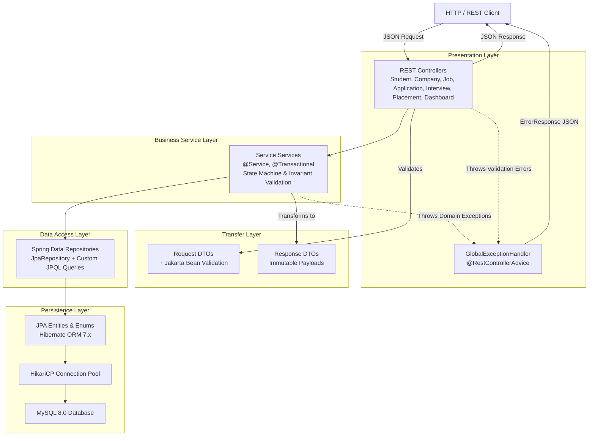
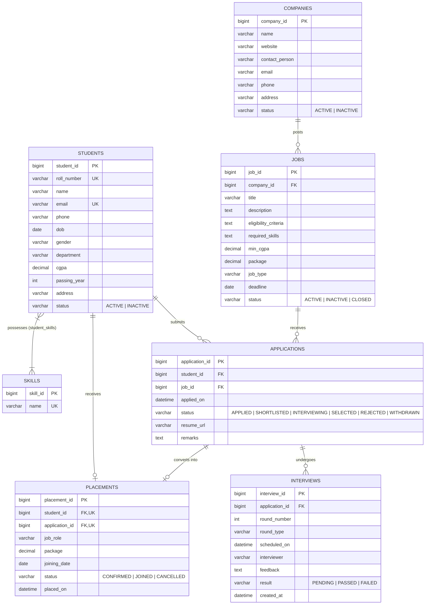

# Placement Management System (PMS)

A robust, enterprise-grade RESTful backend application built with **Java 21**, **Spring Boot 4**, **Spring Data JPA**, and **MySQL**. Engineered to automate and streamline campus placement drive operations, this system coordinates student registrations, skill profiling, company recruitment drives, multi-round interview workflows, eligibility enforcement, and final offer tracking with aggregate institutional metrics.

---

## Table of Contents

- [Overview & Objectives](#overview--objectives)
- [Key Features & Modules](#key-features--modules)
- [Technology Stack](#technology-stack)
- [System Architecture](#system-architecture)
- [Database & Entity Relationship Model](#database--entity-relationship-model)
- [Architectural Layers](#architectural-layers)
- [Implemented Business Workflows & Validation Rules](#implemented-business-workflows--validation-rules)
- [Interactive API Documentation (Swagger / OpenAPI)](#interactive-api-documentation-swagger--openapi)
- [API Reference](#api-reference)
- [Pagination & API Response Conventions](#pagination--api-response-conventions)
- [Sample Request & Response Payloads](#sample-request--response-payloads)
- [Error Handling & Status Codes](#error-handling--status-codes)
- [Automated Testing & Verification](#automated-testing--verification)
- [Local Setup & Configuration Guide](#local-setup--configuration-guide)
- [Production Profile & Cloud Deployment Hardening](#production-profile--cloud-deployment-hardening)
- [Application Health & Monitoring (Spring Boot Actuator)](#application-health--monitoring-spring-boot-actuator)
- [Business Audit Trail](#business-audit-trail)
- [API Rate Limiting](#api-rate-limiting)
- [Security & Deployment Status](#security--deployment-status)
- [Known Limitations](#known-limitations)
- [Future Enhancements (Planned)](#future-enhancements-planned)
- [Technical Competency & Conclusion](#technical-competency--conclusion)

---

## Overview & Objectives

### Problem Statement
Campus placement drives involve complex coordination among hundreds of students, visiting recruiters, and placement coordinators. Traditional methods relying on spreadsheets and ad-hoc communication suffer from:
- Inconsistent tracking of student application statuses across multiple recruitment rounds.
- Manual verification overhead for academic prerequisites (e.g., minimum CGPA thresholds and drive deadlines).
- Risk of duplicate applications or awarding multiple concurrent job placements to a single student without administrative policy checks.
- Lack of centralized, real-time analytics on departmental placement ratios and company participation.

### Solution & Core Objectives
The **Placement Management System (PMS)** provides a centralized REST API backend that:
1. **Enforces Institutional Integrity**: Applies server-side business rules for academic eligibility, drive deadlines, student/company active status, and one-placement-per-student invariants.
2. **Standardizes Multi-Stage Workflows**: Implements a deterministic state machine for job applications (`APPLIED` &rarr; `SHORTLISTED` &rarr; `INTERVIEWING` &rarr; `SELECTED` / `REJECTED` / `WITHDRAWN`) and interview evaluations.
3. **Ensures Data Isolation & Validation**: Separates external client schemas from database persistence models using Data Transfer Objects (DTOs) with declarative Jakarta Bean Validations.
4. **Delivers Operational Intelligence**: Exposes a real-time summary dashboard aggregating metrics across students, companies, job listings, applications, and verified placements.

---

## Key Features & Modules

### 1. Student Management Module
- Register student profiles with academic attributes (roll number, department, CGPA, passing year, contact info).
- Enforces uniqueness constraints on `rollNumber` and `email`.
- Dynamic search and filter by student name, academic department, and enrollment status with Spring Data pagination and sorting.
- Soft deactivation preserving historical placement audit trails.
- Many-to-many skill tagging allowing students to attach technical competencies.

### 2. Company & Corporate Partner Module
- Onboard corporate recruitment partners with domain, contact person, website, and industry details.
- Status management (`ACTIVE`, `INACTIVE`) to govern hiring privileges.
- Filter and search companies by name and status.

### 3. Job Drive Management Module
- Create and manage campus recruitment drives tied to registered companies.
- Specify hiring parameters: compensation package, job role/type, job description, required skills, minimum CGPA eligibility, and application cut-off deadlines.
- Status lifecycle: `ACTIVE`, `INACTIVE`, and `CLOSED`.
- Prevents job creation under inactive corporate accounts.

### 4. Application Processing Module
- Validates student eligibility before application persistence (active enrollment check, active job check, CGPA cutoff comparison, and deadline compliance).
- Prevents duplicate applications via composite uniqueness checks (`student_id` + `job_id`).
- Governed status transitions preventing illegal lifecycle skips (e.g., moving directly from `APPLIED` to terminal `SELECTED`).

### 5. Interview Evaluation Module
- Schedule multi-round interviews (`scheduledOn`, `roundNumber`, `roundType`, `interviewer`) exclusively for shortlisted candidates.
- Automatically transitions the parent application to `INTERVIEWING` upon first round scheduling.
- Eliminates duplicate rounds for the same application.
- Evaluates round outcomes (`PENDING`, `PASSED`, `FAILED`) with detailed evaluator feedback.

### 6. Placement & Offer Management Module
- Issues formal placement records exclusively for candidates with `SELECTED` application status.
- Validates student-application integrity and enforces strict single-placement rules per student.
- Lifecycle tracking for job offers: `CONFIRMED` &rarr; `JOINED` or `CANCELLED`.

### 7. Administrative Analytics Dashboard
- Single-endpoint aggregate overview displaying counts for:
  - Active vs. inactive students.
  - Active vs. inactive corporate partners.
  - Active vs. closed campus job openings.
  - Applications by status breakdown (`APPLIED`, `SHORTLISTED`, `INTERVIEWING`, `SELECTED`, `REJECTED`, `WITHDRAWN`).
  - Placements by status breakdown (`CONFIRMED`, `JOINED`, `CANCELLED`).

---

## Technology Stack

| Layer / Component | Technology | Version | Purpose |
| :--- | :--- | :--- | :--- |
| **Language** | Java (JDK) | **21 LTS** (tested on 21.0.9) | Core language runtime leveraging modern syntax and records |
| **Framework** | Spring Boot | **4.0.7** | Application scaffolding, dependency injection, and autoconfiguration |
| **Web MVC** | Spring Web MVC | **4.0.7** | DispatcherServlet, RESTful controllers, content negotiation |
| **ORM / Persistence** | Hibernate Core | **7.2.19.Final** | Object-Relational Mapping (JPA 3.2 implementation) |
| **Data Access** | Spring Data JPA | **4.0.7** | Repository abstractions, derived queries, dynamic JPQL |
| **Database** | MySQL | **8.0.46** | Relational data persistence and constraint enforcement |
| **JDBC Driver** | MySQL Connector/J | **9.x** (`com.mysql:mysql-connector-j`) | Database connectivity |
| **Connection Pool** | HikariCP | Bundled | Production-grade JDBC connection pooling |
| **Validation** | Jakarta Bean Validation | Bundled (`Hibernate Validator`) | Declarative payload constraint validation |
| **Build Tool** | Apache Maven | Wrapper (`./mvnw`, `mvnw.cmd`) | Build lifecycle, dependency management, test execution |
| **Testing** | JUnit 5 & Spring Boot Test | Bundled | Unit, application context, and slice testing |

---

## System Architecture

The application adopts a clean, layered architectural pattern adhering to separation of concerns and standard Spring Boot conventions:



---

## Database & Entity Relationship Model

The relational schema is mapped across 7 domain entities and 1 join table with strict foreign key constraints and uniqueness rules.



### Relational Invariants & Table Details
- **`students`**: Unique constraints on `roll_number` and `email`.
- **`applications`**: Unique composite constraint `uk_student_job` (`student_id`, `job_id`) guaranteeing a student can apply to a specific job opening only once.
- **`placements`**: Unique constraints on both `student_id` and `application_id` enforcing that a student holds at most one confirmed placement offer and an application can only yield one placement record.
- **`student_skills`**: Join table managing the many-to-many relationship between `students` and `skills`.

---

## Architectural Layers

### 1. Controller Layer (`com.placementmanagementsystem.controller`)
- Exposes RESTful endpoints mapped under `/api/*`.
- Triggers bean validation on incoming payloads using `@Valid`.
- Accepts query parameters for pagination, multi-field sorting, and filtering (`@PageableDefault`).
- Returns standardized `ResponseEntity<T>` with accurate HTTP status codes (`200 OK`, `201 Created`, `204 No Content`).

### 2. Service Layer (`com.placementmanagementsystem.service`)
- Decorated with `@Service` and `@Transactional` (with `@Transactional(readOnly = true)` for query optimization).
- Manages business invariants: eligibility evaluation, duplicate checks, workflow state machine transitions, and soft-delete states.
- Performs bidirectional conversion between JPA entities and DTO contracts.

### 3. Repository Layer (`com.placementmanagementsystem.repository`)
- Extends `JpaRepository<Entity, Long>` for out-of-the-box CRUD and pagination.
- Includes custom derived query methods (e.g., `countByStatus`, `existsByStudent_StudentId`).
- Defines optimized JPQL queries via `@Query` with parameter bindings (`@Param`) for composite filtering with nullable search parameters.

### 4. DTO (Data Transfer Object) Layer (`com.placementmanagementsystem.dto`)
- Decouples domain entities from external clients, preventing over-posting and Jackson circular reference loops.
- Employs Jakarta Validation annotations (`@NotBlank`, `@NotNull`, `@Email`, `@DecimalMin`, `@DecimalMax`, `@PositiveOrZero`).

### 5. Exception Handling Layer (`com.placementmanagementsystem.exception`)
- Centralized `@RestControllerAdvice` converting unchecked domain exceptions into structured `ErrorResponse` payloads.

---

## Implemented Business Workflows & Validation Rules

### 1. Job Application Submission Workflow
When `POST /api/applications` is called, `ApplicationService` enforces seven consecutive checks:
1. **Student Existence**: Resolves `studentId`; throws `StudentNotFoundException` (404) if absent.
2. **Student Activity**: Verifies student `status == ACTIVE`; throws `InactiveStudentException` (400) if inactive.
3. **Job Existence**: Resolves `jobId`; throws `JobNotFoundException` (404) if absent.
4. **Job Status Check**: Verifies job `status == ACTIVE`; throws `JobNotAcceptingApplicationsException` (400) if closed/inactive.
5. **Deadline Verification**: Compares `LocalDate.now()` against `job.getDeadline()`; throws `ApplicationDeadlinePassedException` (400) if expired.
6. **Academic Eligibility (CGPA)**: Verifies student has a recorded CGPA and that `student.getCgpa() >= job.getMinCgpa()`; throws `StudentNotEligibleException` (400) if below threshold.
7. **Duplicate Prevention**: Checks existing applications for the student and job combination; throws `ApplicationAlreadyExistsException` (409) if an entry already exists.

### 2. Application Status State Machine
Status updates via `PUT /api/applications/{id}/status?status={status}` follow a controlled transition model:

```
  +---------+
  | APPLIED |
  +----+----+
       |
       +------------+-----------------------+
       |            |                       |
       v            v                       v
+--------------+ +----------+         +-----------+
| SHORTLISTED  | | REJECTED |         | WITHDRAWN |
+------+-------+ +----------+         +-----------+
       |
       +------------+-----------------------+
       |            |                       |
       v            v                       v
+--------------+ +----------+         +-----------+
| INTERVIEWING | | REJECTED |         | WITHDRAWN |
+------+-------+ +----------+         +-----------+
       |
       +------------+
       |            |
       v            v
+----------+   +----------+
| SELECTED |   | REJECTED |
+----------+   +----------+
```

- **Terminal States**: `SELECTED`, `REJECTED`, and `WITHDRAWN` cannot transition to any other status. Attempting illegal transitions throws `IllegalStateException` (400).

### 3. Interview Scheduling & Progression
- An interview can only be scheduled for an application whose status is either `SHORTLISTED` or `INTERVIEWING`.
- Scheduling the first interview round automatically promotes a `SHORTLISTED` application to `INTERVIEWING`.
- Duplicate round numbers for the same application are blocked with `InterviewAlreadyExistsException` (409).

### 4. Placement Confirmation Workflow
When `POST /api/placements` is called:
1. Validates that the student and application exist in the database.
2. Asserts that the application belongs to the specified student (`PlacementStudentMismatchException` &rarr; 400).
3. Asserts that the application status is `SELECTED` (`ApplicationNotSelectedException` &rarr; 400).
4. Verifies the student has no existing placement records (`PlacementAlreadyExistsException` &rarr; 409).
5. Sets initial placement status to `CONFIRMED`.
6. Placement status progression: `CONFIRMED` can move to `JOINED` or `CANCELLED`. Both `JOINED` and `CANCELLED` are terminal.

---

## Interactive API Documentation (Swagger / OpenAPI)

The Placement Management System provides interactive API documentation via **Swagger UI** and the **OpenAPI 3.1** specification.

| Resource | URL | Description |
| :--- | :--- | :--- |
| **Swagger UI** | `http://localhost:8080/swagger-ui/index.html` (or `/swagger-ui.html`) | Interactive web UI for exploring and executing API endpoints |
| **OpenAPI JSON Contract** | `http://localhost:8080/v3/api-docs` | Raw OpenAPI 3 JSON specification |
| **OpenAPI YAML Contract** | `http://localhost:8080/v3/api-docs.yaml` | Raw OpenAPI 3 YAML specification |

### How to Authenticate & Test Protected Endpoints

1. **Access Swagger UI:**
   Open `http://localhost:8080/swagger-ui/index.html` in your browser.
2. **Obtain a JWT Access Token:**
   - Expand the **Authentication** tag and open `POST /api/auth/login`.
   - Click **Try it out**.
   - Enter registered user credentials (e.g., `{"email": "admin@example.com", "password": "yourPassword"}`).
   - Click **Execute** and copy the `accessToken` value from the JSON response body.
3. **Authorize in Swagger UI:**
   - Click the green **Authorize** button (lock icon) at the top right of the Swagger UI page.
   - In the **bearerAuth** modal, paste the token into the **Value** input field (do not prefix with `Bearer `).
   - Click **Authorize**, then click **Close**.
4. **Invoke Protected Endpoints:**
   - Swagger UI automatically attaches `Authorization: Bearer <token>` to all subsequent requests.
   - Test endpoints according to the authenticated user's role (`ROLE_ADMIN`, `ROLE_COMPANY`, or `ROLE_STUDENT`).

---

## API Reference

Base path for all endpoints: `/api`

### 1. Student Endpoints (`/api/students`)
| Method | Endpoint | Query Parameters | Request Body | Status Code | Description |
| :--- | :--- | :--- | :--- | :--- | :--- |
| `POST` | `/api/students` | None | `StudentRequest` | `201 Created` | Create new student record |
| `GET` | `/api/students` | `department`, `status`, `name`, `page`, `size`, `sort` | None | `200 OK` | Get paginated, filtered students |
| `GET` | `/api/students/{id}` | None | None | `200 OK` | Get student details by ID |
| `PUT` | `/api/students/{id}` | None | `StudentRequest` | `200 OK` | Update existing student record |
| `DELETE` | `/api/students/{id}` | None | None | `204 No Content` | Soft deactivate student (`status = INACTIVE`) |
| `GET` | `/api/students/{studentId}/skills` | None | None | `200 OK` | Retrieve skills assigned to student |
| `POST` | `/api/students/{studentId}/skills/{skillId}` | None | None | `200 OK` | Assign skill to student |
| `DELETE` | `/api/students/{studentId}/skills/{skillId}` | None | None | `204 No Content` | Remove skill from student |

### 2. Company Endpoints (`/api/companies`)
| Method | Endpoint | Query Parameters | Request Body | Status Code | Description |
| :--- | :--- | :--- | :--- | :--- | :--- |
| `POST` | `/api/companies` | None | `CompanyRequest` | `201 Created` | Register corporate partner |
| `GET` | `/api/companies` | `name`, `status`, `page`, `size`, `sort` | None | `200 OK` | Get paginated, filtered companies |
| `GET` | `/api/companies/{id}` | None | None | `200 OK` | Get company details by ID |
| `PUT` | `/api/companies/{id}` | None | `CompanyRequest` | `200 OK` | Update company record |
| `DELETE` | `/api/companies/{id}` | None | None | `204 No Content` | Soft deactivate company (`status = INACTIVE`) |

### 3. Job Endpoints (`/api/jobs`)
| Method | Endpoint | Query Parameters | Request Body | Status Code | Description |
| :--- | :--- | :--- | :--- | :--- | :--- |
| `POST` | `/api/jobs` | None | `JobRequest` | `201 Created` | Post a job opening for an active company |
| `GET` | `/api/jobs` | `title`, `companyId`, `status`, `minCgpa`, `page`, `size`, `sort` | None | `200 OK` | Get paginated, filtered jobs |
| `GET` | `/api/jobs/{id}` | None | None | `200 OK` | Get job listing by ID |
| `PUT` | `/api/jobs/{id}` | None | `JobRequest` | `200 OK` | Update job posting attributes |
| `DELETE` | `/api/jobs/{id}` | None | None | `204 No Content` | Close job opening (`status = CLOSED`) |

### 4. Application Endpoints (`/api/applications`)
| Method | Endpoint | Query Parameters | Request Body | Status Code | Description |
| :--- | :--- | :--- | :--- | :--- | :--- |
| `POST` | `/api/applications` | None | `ApplicationRequest` | `201 Created` | Submit application with eligibility verification |
| `GET` | `/api/applications` | `studentId`, `jobId`, `status`, `page`, `size`, `sort` | None | `200 OK` | Get paginated, filtered applications |
| `GET` | `/api/applications/{id}` | None | None | `200 OK` | Get application details by ID |
| `PUT` | `/api/applications/{id}` | None | `ApplicationUpdateRequest` | `200 OK` | Update application details (`resumeUrl`, `remarks`) |
| `PUT` | `/api/applications/{id}/status` | `status` (Required Enum) | None | `200 OK` | Transition application lifecycle status |

### 5. Interview Endpoints (`/api/interviews`)
| Method | Endpoint | Query Parameters | Request Body | Status Code | Description |
| :--- | :--- | :--- | :--- | :--- | :--- |
| `POST` | `/api/interviews` | None | `InterviewRequest` | `201 Created` | Schedule an interview round for application |
| `GET` | `/api/interviews` | `applicationId`, `result`, `page`, `size`, `sort` | None | `200 OK` | Get paginated, filtered interviews |
| `GET` | `/api/interviews/{id}` | None | None | `200 OK` | Get interview round details by ID |
| `GET` | `/api/interviews/application/{applicationId}` | None | None | `200 OK` | Get all rounds for an application (ordered by round number) |
| `PUT` | `/api/interviews/{id}` | None | `InterviewRequest` | `200 OK` | Update interview details or feedback |
| `DELETE` | `/api/interviews/{id}` | None | None | `204 No Content` | Delete interview round record |

### 6. Placement Endpoints (`/api/placements`)
| Method | Endpoint | Query Parameters | Request Body | Status Code | Description |
| :--- | :--- | :--- | :--- | :--- | :--- |
| `POST` | `/api/placements` | None | `PlacementRequest` | `201 Created` | Confirm offer for a `SELECTED` application |
| `GET` | `/api/placements` | `status`, `page`, `size`, `sort` | None | `200 OK` | Get paginated, filtered placement records |
| `GET` | `/api/placements/{id}` | None | None | `200 OK` | Get placement record by ID |
| `GET` | `/api/placements/student/{studentId}` | None | None | `200 OK` | Get placement record for specific student |
| `PUT` | `/api/placements/{id}` | None | `PlacementRequest` | `200 OK` | Update role, package, or joining date |
| `PUT` | `/api/placements/{id}/status` | `status` (Required Enum) | None | `200 OK` | Transition placement status (`JOINED`, `CANCELLED`) |

### 7. Dashboard Endpoints (`/api/dashboard`)
| Method | Endpoint | Query Parameters | Request Body | Status Code | Description |
| :--- | :--- | :--- | :--- | :--- | :--- |
| `GET` | `/api/dashboard/summary` | None | None | `200 OK` | Retrieve aggregated placement cell metrics |

---

## Pagination & API Response Conventions

All listing endpoints in the Placement Management System that support search and bulk retrieval adhere to standard Spring Data pagination and sorting conventions.

### 1. Pagination Parameters

| Query Parameter | Type | Default Value | Description |
| :--- | :--- | :--- | :--- |
| `page` | `Integer` | `0` | **Zero-based** page index. `page=0` is the first page. |
| `size` | `Integer` | `10` | Number of items per page. Clamped between `1` and `2000` (max safety limit). |
| `sort` | `String` | Endpoint specific | Property name and direction separated by comma (e.g. `sort=studentId,asc` or `sort=name,desc`). Multiple sort properties are supported. |

### 2. Default Sorting by Endpoint

Each paginated endpoint specifies an explicit `@PageableDefault` fallback sort:

| Endpoint | Default Size | Default Sort Property & Direction |
| :--- | :--- | :--- |
| `GET /api/students` | `10` | `studentId,asc` |
| `GET /api/companies` | `10` | `companyId,asc` |
| `GET /api/jobs` | `10` | `jobId,asc` |
| `GET /api/applications` | `10` | `applicationId,asc` |
| `GET /api/interviews` | `10` | `interviewId,asc` |
| `GET /api/placements` | `10` | `placementId,asc` |

### 3. Combining Pagination with Filters

Query filters and pagination work seamlessly together:
- **Filter students by department and status, sorted by name**:
  ```http
  GET /api/students?department=Computer Science&status=ACTIVE&name=Jane&page=0&size=10&sort=name,asc
  ```
- **Filter jobs by company and minimum package, sorted by package descending**:
  ```http
  GET /api/jobs?companyId=1&status=ACTIVE&minCgpa=7.50&page=0&size=10&sort=packageAmount,desc
  ```
- **Filter applications by student and status**:
  ```http
  GET /api/applications?studentId=1&status=APPLIED&page=0&size=5&sort=appliedOn,desc
  ```
- **Filter interviews by application and outcome**:
  ```http
  GET /api/interviews?applicationId=1&result=PENDING&page=0&size=5&sort=scheduledOn,asc
  ```
- **Filter confirmed placements sorted by package**:
  ```http
  GET /api/placements?status=CONFIRMED&page=0&size=10&sort=packageAmount,desc
  ```

### 4. Input Boundary & Error Handling

- **Negative page number** (`page=-1`): Spring Data safely clamps to page `0`.
- **Zero or negative size** (`size=0` / `size=-5`): Spring Data safely falls back to the default page size (`10`).
- **Excessively large size** (`size=999999`): Spring Data safely clamps to the upper bound (`2000`).
- **Non-numeric page/size** (`page=abc`): Spring Data safely falls back to default page 0 without resulting in HTTP 500.
- **Request beyond last page** (e.g., page 99 when only 1 exists): Returns HTTP 200 OK with `"content": []`, `"empty": true`, and correct total counts.
- **Database Query Translation**: Spring Data JPA translates pageable sorting properties directly into SQL `ORDER BY` clauses. Note that sorting on unindexed database columns may increase query execution costs on large datasets.
- **Invalid sort property** (e.g., `sort=nonExistentProperty`): Caught by `GlobalExceptionHandler` and translated to HTTP 400 Bad Request:
  ```json
  {
    "timestamp": "2026-11-03T01:20:00",
    "status": 400,
    "error": "Bad Request",
    "message": "Invalid sort property 'nonExistentProperty'",
    "path": "/api/students"
  }
  ```

> **Note on Page Serialization & Backward Compatibility**:
> Spring Data Commons logs an informational warning when serializing `PageImpl` instances directly, noting that direct serialization structure is not guaranteed to remain stable across framework versions. The Placement Management System intentionally retains the established, root-level JSON format to preserve backward compatibility for API consumers, with a planned migration to a dedicated DTO-based `PagedModel` in a future iteration.

### 5. Standard Paginated Response Structure

Paginated endpoints return a structured Spring Data `Page` object:

```json
{
  "content": [
    {
      "studentId": 1,
      "rollNumber": "CS2026001",
      "name": "Jane Doe",
      "email": "jane.doe@example.com",
      "department": "Computer Science",
      "cgpa": 8.75,
      "status": "ACTIVE"
    }
  ],
  "pageable": {
    "pageNumber": 0,
    "pageSize": 10,
    "sort": {
      "empty": false,
      "sorted": true,
      "unsorted": false
    },
    "offset": 0,
    "paged": true,
    "unpaged": false
  },
  "totalElements": 1,
  "totalPages": 1,
  "last": true,
  "size": 10,
  "number": 0,
  "sort": {
    "empty": false,
    "sorted": true,
    "unsorted": false
  },
  "numberOfElements": 1,
  "first": true,
  "empty": false
}
```

### 6. Non-Paginated API Response Conventions

Endpoints that do not return paginated listings follow clear, consistent RESTful conventions:

| Operation Type | HTTP Status | Response Format | Example Endpoints |
| :--- | :--- | :--- | :--- |
| **Single Resource Retrieval** | `200 OK` | Single Resource DTO | `GET /api/students/{id}`, `GET /api/jobs/{id}`, `GET /api/companies/{id}` |
| **Resource Creation** | `201 Created` | Created Resource DTO | `POST /api/students`, `POST /api/jobs`, `POST /api/applications` |
| **Resource Update** | `200 OK` | Updated Resource DTO | `PUT /api/students/{id}`, `PUT /api/jobs/{id}`, `PUT /api/applications/{id}/status` |
| **Resource Deletion** | `204 No Content` | Empty response body | `DELETE /api/students/{id}`, `DELETE /api/jobs/{id}`, `DELETE /api/interviews/{id}` |
| **Sub-Resource Associations** | `200 OK` / `204 No Content` | Associated entity or empty | `POST /api/students/{id}/skills/{skillId}` (200), `DELETE .../skills/{skillId}` (204) |
| **Bounded List Endpoints** | `200 OK` | Direct JSON Array | `GET /api/students/{id}/skills` (Set), `GET /api/interviews/application/{id}` (List), `GET /api/placements/student/{id}/history` (List) |
| **Metrics Summary** | `200 OK` | Aggregate DTO | `GET /api/dashboard/summary` |
| **Client / Validation Error** | `400` / `401` / `403` / `404` / `409` | Standardized `ErrorResponse` | Structured error object with timestamp, status, path, message, and validationErrors |

---

## Sample Request & Response Payloads

### 1. Register Student (`POST /api/students`)
**Request Body**:
```json
{
  "rollNumber": "CS2026001",
  "name": "Jane Doe",
  "email": "jane.doe@example.com",
  "phone": "+91-9876543210",
  "dob": "2003-05-15",
  "gender": "Female",
  "department": "Computer Science",
  "cgpa": 8.75,
  "passingYear": 2026,
  "address": "42 Tech Boulevard, Bangalore",
  "status": "ACTIVE"
}
```
**Response Body (`201 Created`)**:
```json
{
  "studentId": 1,
  "rollNumber": "CS2026001",
  "name": "Jane Doe",
  "email": "jane.doe@example.com",
  "phone": "+91-9876543210",
  "dob": "2003-05-15",
  "gender": "Female",
  "department": "Computer Science",
  "cgpa": 8.75,
  "passingYear": 2026,
  "address": "42 Tech Boulevard, Bangalore",
  "status": "ACTIVE"
}
```

---

### 2. Post a Job Drive (`POST /api/jobs`)
**Request Body**:
```json
{
  "companyId": 1,
  "title": "Software Development Engineer - Backend",
  "description": "Designing high-scale Java Spring Boot microservices.",
  "eligibilityCriteria": "B.Tech Computer Science or IT with >= 7.5 CGPA and no backlogs.",
  "requiredSkills": "Java, Spring Boot, MySQL, REST APIs",
  "minCgpa": 7.50,
  "packageAmount": 1400000.00,
  "jobType": "Full-Time",
  "deadline": "2026-11-30",
  "status": "ACTIVE"
}
```
**Response Body (`201 Created`)**:
```json
{
  "jobId": 1,
  "companyId": 1,
  "companyName": "Acme Technologies Corp",
  "title": "Software Development Engineer - Backend",
  "description": "Designing high-scale Java Spring Boot microservices.",
  "eligibilityCriteria": "B.Tech Computer Science or IT with >= 7.5 CGPA and no backlogs.",
  "requiredSkills": "Java, Spring Boot, MySQL, REST APIs",
  "minCgpa": 7.50,
  "packageAmount": 1400000.00,
  "jobType": "Full-Time",
  "deadline": "2026-11-30",
  "status": "ACTIVE"
}
```

---

### 3. Submit Application (`POST /api/applications`)
**Request Body**:
```json
{
  "studentId": 1,
  "jobId": 1,
  "resumeUrl": "https://storage.example.com/resumes/CS2026001-JaneDoe.pdf",
  "remarks": "Strong Java backend and database foundations."
}
```
**Response Body (`201 Created`)**:
```json
{
  "applicationId": 1,
  "studentId": 1,
  "studentName": "Jane Doe",
  "jobId": 1,
  "jobTitle": "Software Development Engineer - Backend",
  "companyName": "Acme Technologies Corp",
  "appliedOn": "2026-10-27T16:45:00",
  "status": "APPLIED",
  "resumeUrl": "https://storage.example.com/resumes/CS2026001-JaneDoe.pdf",
  "remarks": "Strong Java backend and database foundations."
}
```

---

### 4. Schedule Interview Round (`POST /api/interviews`)
**Request Body**:
```json
{
  "applicationId": 1,
  "roundNumber": 1,
  "roundType": "Technical Coding & Data Structures",
  "scheduledOn": "2026-11-05T10:00:00",
  "interviewer": "Engineering Lead - Core Platform",
  "feedback": "Pending assessment.",
  "result": "PENDING"
}
```
**Response Body (`201 Created`)**:
```json
{
  "interviewId": 1,
  "applicationId": 1,
  "roundNumber": 1,
  "roundType": "Technical Coding & Data Structures",
  "scheduledOn": "2026-11-05T10:00:00",
  "interviewer": "Engineering Lead - Core Platform",
  "feedback": "Pending assessment.",
  "result": "PENDING",
  "createdAt": "2026-10-27T16:48:00"
}
```

---

### 5. Issue Placement Record (`POST /api/placements`)
**Request Body**:
```json
{
  "studentId": 1,
  "applicationId": 1,
  "jobRole": "Software Development Engineer - Backend",
  "packageAmount": 1400000.00,
  "joiningDate": "2026-07-01",
  "status": "CONFIRMED"
}
```
**Response Body (`201 Created`)**:
```json
{
  "placementId": 1,
  "studentId": 1,
  "studentName": "Jane Doe",
  "applicationId": 1,
  "jobRole": "Software Development Engineer - Backend",
  "packageAmount": 1400000.00,
  "joiningDate": "2026-07-01",
  "status": "CONFIRMED",
  "placedOn": "2026-10-27T17:00:00"
}
```

---

### 6. Analytics Dashboard Summary (`GET /api/dashboard/summary`)
**Response Body (`200 OK`)**:
```json
{
  "totalStudents": 150,
  "activeStudents": 142,
  "inactiveStudents": 8,
  "totalCompanies": 25,
  "activeCompanies": 22,
  "inactiveCompanies": 3,
  "totalJobs": 35,
  "activeJobs": 28,
  "closedJobs": 7,
  "totalApplications": 210,
  "appliedApplications": 65,
  "shortlistedApplications": 45,
  "interviewingApplications": 30,
  "selectedApplications": 20,
  "rejectedApplications": 40,
  "withdrawnApplications": 10,
  "totalPlacements": 20,
  "confirmedPlacements": 18,
  "joinedPlacements": 2,
  "cancelledPlacements": 0
}
```

---

## Error Handling & Status Codes

All errors thrown during request execution are intercepted by `GlobalExceptionHandler` (`@RestControllerAdvice`) and converted into standardized HTTP responses.

### Handled Status Codes & Exception Mapping

| HTTP Status | Exception Types Mapped | Root Cause / Trigger Condition |
| :--- | :--- | :--- |
| **`404 NOT FOUND`** | `StudentNotFoundException`<br/>`CompanyNotFoundException`<br/>`JobNotFoundException`<br/>`ApplicationNotFoundException`<br/>`InterviewNotFoundException`<br/>`PlacementNotFoundException`<br/>`SkillNotFoundException` | Resource with the requested identifier does not exist in the database |
| **`409 CONFLICT`** | `DuplicateStudentException`<br/>`ApplicationAlreadyExistsException`<br/>`InterviewAlreadyExistsException`<br/>`PlacementAlreadyExistsException`<br/>`SkillAlreadyAssignedException` | Violations of domain uniqueness constraints (duplicate roll number, email, re-applying to same job, re-scheduling same round, or multiple placements) |
| **`400 BAD REQUEST`**<br/>*(Business Rule)* | `StudentNotEligibleException`<br/>`JobNotAcceptingApplicationsException`<br/>`ApplicationDeadlinePassedException`<br/>`InactiveStudentException`<br/>`InactiveCompanyException`<br/>`ApplicationNotSelectedException`<br/>`PlacementStudentMismatchException`<br/>`IllegalStateException` | Attempting an invalid domain operation (applying below minimum CGPA, post-deadline application, illegal state machine transition, creating placement for non-selected application) |
| **`400 BAD REQUEST`**<br/>*(Bean Validation)* | `MethodArgumentNotValidException` | Incoming payload violates Jakarta constraint annotations (`@NotBlank`, `@DecimalMin`, `@Email`, etc.) |

### Sample Error Responses

#### 1. Business Logic / Invariant Violation (`400 Bad Request`)
```json
{
  "timestamp": "2026-10-27T16:52:14.312",
  "status": 400,
  "error": "Bad Request",
  "message": "Student CGPA (7.20) is below the minimum required CGPA (8.00) for this job",
  "path": "/api/applications"
}
```

#### 2. Duplicate Resource / Conflict (`409 Conflict`)
```json
{
  "timestamp": "2026-10-27T16:53:05.108",
  "status": 409,
  "error": "Conflict",
  "message": "Student with roll number CS2026001 already exists",
  "path": "/api/students"
}
```

#### 3. Payload Validation Failure (`400 Bad Request`)
```json
{
  "timestamp": "2026-10-27T16:54:20.912",
  "status": 400,
  "error": "Bad Request",
  "message": "Validation failed for one or more fields",
  "validationErrors": {
    "email": "Email must be valid",
    "rollNumber": "Roll number is required",
    "cgpa": "CGPA cannot exceed 10.0"
  },
  "path": "/api/students"
}
```

---

## Automated Testing & Verification

### Test Suite Overview
The repository features an enterprise-grade automated testing suite spanning unit, slice, and integration tests:

1. **Isolated Test Suite (250 tests)**:
   - **Controller Slice Tests (`@WebMvcTest`)**: All 8 controllers verified with `MockMvc` for routing, status codes, input validation, service invocation, and response structures.
   - **Pagination Verification Tests**: All 6 paginated endpoints verified with `ArgumentCaptor` for zero-based indexing, `@PageableDefault`, sorting directions, query filters, boundary clamping, and invalid sort handling.
   - **Service Unit Tests**: Business rules, invariants, CGPA eligibility, deadlines, state machines, and ownership checks verified with Mockito.
   - **Security & Authorization Tests**: Method security (`@PreAuthorize`), role hierarchy (`ROLE_ADMIN`, `ROLE_COMPANY`, `ROLE_STUDENT`), and student privacy verified.
   - **OpenAPI / Swagger Contract Tests**: Verification of Swagger UI accessibility and security scheme mappings.
   - **DTO & Exception Handling Tests**: Comprehensive Bean Validation and centralized `@RestControllerAdvice` error response mapping.

2. **Database-Backed Integration Tests**:
   - `PlacementManagementSystemApplicationTests`: Full Spring Boot context bootstrap, JPA repositories, and HikariCP connection pool acquisition against MySQL.
   - `TransactionalRollbackIntegrationTest`: Multi-entity atomic transaction rollback verification.
   - `ConcurrencyIntegrationTest`: High-concurrency race condition and deadlock protection verification.

### Running Tests

**Run the isolated test suite** (does not require a running MySQL database):
```powershell
.\mvnw.cmd test "-Dtest=!PlacementManagementSystemApplicationTests,!TransactionalRollbackIntegrationTest,!ConcurrencyIntegrationTest"
```

**Run all controller and pagination tests**:
```powershell
.\mvnw.cmd test "-Dtest=PaginationVerificationTest,*ControllerTest"
```

---

## Local Setup & Configuration Guide

### Prerequisites
Before running the application locally, ensure you have installed:
1. **Java Development Kit (JDK) 21** or higher:
   ```bash
   java -version
   ```
2. **MySQL Server 8.0+** running locally on port `3306`:
   ```bash
   mysql --version
   ```
3. **Git** for version control.

---

### Step 1: Database Initialization
Log into your MySQL terminal or GUI client (e.g., MySQL Workbench) and create the database schema:

```sql
CREATE DATABASE IF NOT EXISTS placement_management_system
  CHARACTER SET utf8mb4
  COLLATE utf8mb4_unicode_ci;
```

---

### Step 2: Secure Datasource Configuration
Never commit database passwords or credentials to source control. The application supports standard environment variables to override default credentials safely.

#### Option A: Using Environment Variables (Recommended)
Set the following environment variables in your terminal before launching the application:

**Linux / macOS (Bash / Zsh)**:
```bash
export SPRING_DATASOURCE_URL="jdbc:mysql://localhost:3306/placement_management_system?useSSL=false&allowPublicKeyRetrieval=true&serverTimezone=UTC"
export SPRING_DATASOURCE_USERNAME="your_mysql_username"
export SPRING_DATASOURCE_PASSWORD="your_mysql_password"
```

**Windows (PowerShell)**:
```powershell
$env:SPRING_DATASOURCE_URL="jdbc:mysql://localhost:3306/placement_management_system?useSSL=false&allowPublicKeyRetrieval=true&serverTimezone=UTC"
$env:SPRING_DATASOURCE_USERNAME="your_mysql_username"
$env:SPRING_DATASOURCE_PASSWORD="your_mysql_password"
```

#### Option B: Using an Uncommitted Local Configuration File
Create an untracked local profile file `src/main/resources/application-local.properties` (ensure it is added to `.gitignore`):

```properties
spring.datasource.url=jdbc:mysql://localhost:3306/placement_management_system
spring.datasource.username=your_username
spring.datasource.password=your_password
spring.jpa.hibernate.ddl-auto=update
spring.jpa.show-sql=true
```

Run with the local profile active:
```bash
./mvnw spring-boot:run -Dspring-boot.run.profiles=local
```

---

### Step 3: Build & Test the Project

**Compile and package without tests**:
```bash
./mvnw clean package -DskipTests
```

**Execute the test suite**:
```bash
# Linux / macOS
./mvnw test

# Windows
.\mvnw.cmd test
```

---

### Step 4: Run the Application

**Using Maven Wrapper**:
```bash
# Linux / macOS
./mvnw spring-boot:run

# Windows
.\mvnw.cmd spring-boot:run
```

**Running the generated JAR artifact**:
```bash
java -jar target/placement-management-system-0.0.1-SNAPSHOT.jar
```

The application will start on **`http://localhost:8080`**.

---

## Production Profile & Cloud Deployment Hardening

The Placement Management System features a dedicated **production configuration profile (`prod`)** defined within `application.properties` using Spring Boot multi-document configuration (`#---` and `spring.config.activate.on-profile=prod`).

### Activating the Production Profile

Activate the `prod` profile using either the JVM system property or the standard environment variable:

**Using JVM Argument**:
```bash
java -Dspring.profiles.active=prod -jar target/placement-management-system-0.0.1-SNAPSHOT.jar
```

**Using Environment Variable**:
```bash
# Linux / macOS
export SPRING_PROFILES_ACTIVE=prod

# Windows (PowerShell)
$env:SPRING_PROFILES_ACTIVE="prod"
```

### Required Production Environment Variables

When running under the `prod` profile, all insecure defaults and development fallbacks are removed. The application enforces fail-fast startup if any mandatory variable is missing:

| Environment Variable | Mandatory? | Description / Format | Example Placeholder |
| :--- | :--- | :--- | :--- |
| `SPRING_DATASOURCE_URL` | Yes | JDBC URL to MySQL (e.g. AWS RDS) | `jdbc:mysql://<rds-host>:3306/placement_management_system` |
| `SPRING_DATASOURCE_USERNAME` | Yes | Database username | `<db-username>` |
| `SPRING_DATASOURCE_PASSWORD` | **Yes** | Database password (no fallback permitted) | `<set-your-secret-securely>` |
| `JWT_SECRET` | **Yes** | Base64-encoded HMAC key (min 256 bits / 32 bytes) | `<base64-encoded-256bit-secret>` |
| `CORS_ALLOWED_ORIGINS` | **Yes** | Comma-separated list of allowed web frontend origins | `https://pms.example.com,https://admin.pms.example.com` |
| `SWAGGER_ENABLED` | Optional | Controls Swagger UI in production (defaults to `false`) | `false` |
| `API_DOCS_ENABLED` | Optional | Controls OpenAPI JSON in production (defaults to `false`) | `false` |
| `DB_POOL_MAX_SIZE` | Optional | HikariCP maximum connection pool size (defaults to `10`) | `10` |
| `DB_POOL_MIN_IDLE` | Optional | HikariCP minimum idle connection count (defaults to `5`) | `5` |
| `SPRING_JPA_SHOW_SQL` | Optional | SQL console logging (strictly `false` in production) | `false` |

> [!CAUTION]
> **No Hardcoded Secrets**: Never commit real database passwords, AWS credentials, or JWT signing keys to source control, configuration files, or logs. Always inject secrets at runtime via container environment variables or AWS Secrets Manager.

### Frontend CORS Origin Configuration

In production, CORS does not permit unauthenticated origin fallbacks (e.g. `localhost`). Set `CORS_ALLOWED_ORIGINS` to the exact protocol and domain of the client application(s):

```bash
export CORS_ALLOWED_ORIGINS="https://placement.university.edu,https://recruiter.university.edu"
```

### Controlled Swagger / OpenAPI Exposure in Production

By default, Swagger UI (`/swagger-ui.html`) and OpenAPI JSON (`/v3/api-docs`) are **disabled** in the `prod` profile to prevent reconnaissance of internal endpoints and schemas.

If API documentation is required in a private staging or restricted internal environment, set:
```bash
export SWAGGER_ENABLED=true
export API_DOCS_ENABLED=true
```

### Database Schema Safety: Why Production Uses `ddl-auto=validate`

In local development, Hibernate uses `ddl-auto=update` to automatically create and synchronize tables with JPA entity definitions.

In production, `ddl-auto` is strictly locked to **`validate`**:
- **Prevents Accidental Schema Mutation**: Prevents application nodes from running implicit DDL modifications (`ALTER TABLE`) during container startup.
- **Zero-Downtime / Multi-Instance Safety**: When running multiple replica tasks behind an AWS Application Load Balancer, simultaneous startup in `update` mode causes race conditions, table locks, and potential deadlock failures. `validate` guarantees read-only schema verification.
- **Pre-Deployment Migration Requirement**:
  > [!IMPORTANT]
  > Before deploying new application versions with updated entity fields or new tables to production, database schema changes must be applied using structured migration scripts (e.g. Flyway) prior to launching the updated application containers. If the database schema does not match the JPA entity mappings, the application will fail fast on startup with a schema validation error.

---

## Application Health & Monitoring (Spring Boot Actuator)

The Placement Management System integrates **Spring Boot Actuator** to provide production-ready health monitoring and availability probes for container orchestration platforms (e.g., Kubernetes, Docker) and load balancers.

### Available Endpoints

| HTTP Method | Endpoint | Access | Purpose |
| :--- | :--- | :--- | :--- |
| `GET` | `/actuator/health` | **Public** (No JWT required) | Overall system health status (returns `{"status":"UP"}`) |
| `GET` | `/actuator/health/liveness` | **Public** (No JWT required) | Liveness probe indicating if the application runtime is healthy and running |
| `GET` | `/actuator/health/readiness` | **Public** (No JWT required) | Readiness probe indicating if the application is ready to accept HTTP traffic |

### Liveness and Readiness Probes

- **Liveness (`/actuator/health/liveness`)**: Indicates whether the internal application state is operational. If a severe failure occurs (e.g., deadlock or unrecoverable fatal condition), an orchestrator can restart the container.
- **Readiness (`/actuator/health/readiness`)**: Indicates whether the application is fully initialized and prepared to route user requests. Traffic is routed only when readiness reports `UP`.

### Conservative Security & Information Protection

1. **Hidden Health Details (`management.endpoint.health.show-details=never`)**: Component-level diagnostic trees, database URLs, disk space numbers, exception stack traces, and internal service states are never exposed in health responses.
2. **Strict Endpoint Exposure (`management.endpoints.web.exposure.include=health`)**: Sensitive Actuator management endpoints—such as `/actuator/env`, `/actuator/beans`, `/actuator/configprops`, `/actuator/metrics`, `/actuator/mappings`, `/actuator/loggers`, and heap/thread dump endpoints—are disabled over HTTP and return `404 Not Found`.
3. **Narrow Security Matchers**: Spring Security permits anonymous access strictly to `/actuator/health`, `/actuator/health/liveness`, and `/actuator/health/readiness`. All business APIs continue to require valid JWT authentication and role authorization.

---

## Business Audit Trail

The Placement Management System implements a dedicated, database-backed **Business Audit Trail** (`audit_logs`) to record critical business lifecycle operations across students, recruitment drives, applications, evaluations, and offers.

### Architecture & Design

- **Layered Integration**: The audit module consists of `AuditLog` (JPA Entity), `AuditLogRepository` (Spring Data JPA), and `AuditService` (Service Layer).
- **Decoupled Identity Preservation**: The `audit_logs` table deliberately omits direct JPA foreign-key relations to business entities (e.g., `User`, `Job`, `Student`). Instead, it stores scalar entity IDs (`actor_id`, `entity_id`). This ensures that audit records remain permanently immutable and are never deleted or corrupted if associated business entities are deactivated or deleted.
- **Automated Actor Resolution**: Authenticated user IDs are automatically derived from the active `SecurityContext` via `SecurityHelper`. For unauthenticated or system events, `actor_id` safely defaults to `null`.

### Tracked Business Events

| Action | Affected Entity | Triggering Operation | Description Summary |
| :--- | :--- | :--- | :--- |
| `STUDENT_REGISTERED` | `STUDENT` | `AuthService.registerStudent` | Student self-registration completed |
| `JOB_CREATED` | `JOB` | `JobService.createJob` | Campus recruitment job created |
| `JOB_UPDATED` | `JOB` | `JobService.updateJob` | Job posting details updated |
| `JOB_CLOSED` | `JOB` | `JobService.closeJob` | Job posting closed for applications |
| `APPLICATION_SUBMITTED` | `APPLICATION` | `ApplicationService.createApplication` | Job application submitted |
| `APPLICATION_STATUS_UPDATED` | `APPLICATION` | `ApplicationService.updateApplicationStatus` | Application status transition recorded |
| `INTERVIEW_SCHEDULED` | `INTERVIEW` | `InterviewService.scheduleInterview` | Interview round scheduled |
| `INTERVIEW_UPDATED` | `INTERVIEW` | `InterviewService.updateInterview` | Interview evaluation result updated |
| `PLACEMENT_CREATED` | `PLACEMENT` | `PlacementService.createPlacement` | Formal placement offer issued |

### Stored Schema & Indexing

| Column | Type | Nullable | Details / Indexing |
| :--- | :--- | :--- | :--- |
| `audit_id` | `BIGINT` | No | Primary Key (`IDENTITY`) |
| `actor_id` | `BIGINT` | Yes | Indexed (`idx_audit_logs_actor_id`) for fast user activity lookups |
| `action` | `VARCHAR(50)` | No | Enum name representing the business action |
| `entity_type` | `VARCHAR(50)` | No | Composite index (`idx_audit_logs_entity`) on `(entity_type, entity_id)` |
| `entity_id` | `BIGINT` | No | Composite index (`idx_audit_logs_entity`) on `(entity_type, entity_id)` |
| `description` | `VARCHAR(255)` | No | Brief, non-sensitive textual outcome summary |
| `created_at` | `DATETIME(6)` | No | Indexed (`idx_audit_logs_created_at`) for time-range filtering and sorting |

### Transactional Guarantees

- **Atomic Co-Persistence**: `AuditService.recordAudit` executes within the active database transaction of the enclosing service method (`Propagation.REQUIRED`).
- **Rollback Guarantee**: If any validation rule, database constraint, or downstream operation fails, the business transaction aborts and the audit entry is automatically rolled back with the business data. No phantom audit logs can ever exist for failed operations.
- **Fail-Safe Integrity**: Read-only queries (`GET` requests) are never audited, preventing audit table bloat.

### Privacy & Security Hygiene

- **Zero Secrets**: Passwords, hashes, JWT tokens, Bearer strings, and secret credentials are never stored in audit records.
- **Zero PII Exposure**: Student names, emails, roll numbers, phone numbers, and physical addresses are strictly excluded from audit descriptions.
- **No Payload Blobs**: Entire request or response JSON bodies are excluded to eliminate storage bloat and prevent accidental data leakage.
- **Internal-Only Access**: No public REST endpoint exposes the audit log repository or service; audit querying remains internal to the application.

---

## API Rate Limiting

The Placement Management System protects sensitive authentication endpoints against brute-force credential stuffing, dictionary attacks, and denial-of-service (DoS) attempts using an in-memory **Token Bucket Algorithm**.

### Protected Endpoints & Configurable Policies

Rate limiting runs in a dedicated servlet filter (`RateLimitingFilter`) placed **before** authentication processing in the Spring Security filter chain:

| HTTP Method | Target Endpoint | Default Capacity | Refill Rate | Scope |
| :--- | :--- | :--- | :--- | :--- |
| `POST` | `/api/auth/login` | **5 requests** | 5 tokens / 60 seconds (1 token every 12s) | Per Client IP |
| `POST` | `/api/auth/register` | **5 requests** | 5 tokens / 60 seconds (1 token every 12s) | Per Client IP |

All limits and durations can be tuned via `application.properties` or environment variables without changing source code:
`properties
application.rate-limiting.enabled=true
application.rate-limiting.login.limit=5
application.rate-limiting.login.duration-in-seconds=60
application.rate-limiting.register.limit=5
application.rate-limiting.register.duration-in-seconds=60
application.rate-limiting.trusted-proxy=false
application.rate-limiting.max-buckets=10000
`

### HTTP 429 Too Many Requests Behavior

When a client IP exhausts its token budget for an endpoint:
1. **HTTP Status**: Returns `429 Too Many Requests`.
2. **Standard Header**: Sends `Retry-After: <seconds>` indicating the exact wait time before the next token refills.
3. **Consistent Error Payload**: Emits the standard `ErrorResponse` JSON structure:
`json
{
  "timestamp": "2026-11-04T22:45:00",
  "status": 429,
  "error": "Too Many Requests",
  "message": "Too many requests. Please try again after 12 seconds.",
  "path": "/api/auth/login"
}
`
4. **Isolated Scope**: Public read-only endpoints (e.g., `GET /api/jobs`, `GET /actuator/health`) and authenticated business endpoints are never throttled by auth rate limiting.

### Client IP Resolution & Security

- **Anti-Spoofing by Default**: When `application.rate-limiting.trusted-proxy=false` (default), the service reads `request.getRemoteAddr()`, completely ignoring caller-manipulated `X-Forwarded-For` headers.
- **Reverse Proxy Compatibility**: When deployed behind an AWS Application Load Balancer (ALB) or Nginx reverse proxy, setting `application.rate-limiting.trusted-proxy=true` safely extracts the original client IP from the first segment of `X-Forwarded-For` with format validation.

### In-Memory Limitations & Path to Horizontal Scaling (AWS)

- **Single-Instance Deployment**: Buckets are currently managed in-memory using a thread-safe `ConcurrentHashMap` with bounded memory management (`max-buckets=10000`) and idle bucket eviction.
- **Horizontal Scaling Evolution**: In a multi-instance deployment (e.g., multiple ECS/EC2 instances behind an AWS ALB without sticky sessions), an in-memory bucket store would partition token counts across instances. For multi-node AWS deployment, this in-memory `RateLimitingService` should be swapped with a distributed cache provider such as **Redis** / **Amazon ElastiCache** using atomic Redis `INCR` or a distributed Bucket4j Redis backend.

---

## Security & Deployment Status

- **Authentication & Authorization**: Implemented using **Spring Security 7** with stateless JSON Web Tokens (**JJWT**).
- **Role-Based Access Control (RBAC)**: Enforces three distinct roles (`ROLE_ADMIN`, `ROLE_COMPANY`, `ROLE_STUDENT`) via URL security matchers and method-level `@PreAuthorize` rules.
- **Data Privacy & Ownership**: Student privacy checks prevent students from viewing other candidates' applications; company ownership checks restrict recruiters to modifying only their own drives and interviews.
- **Deployment Status**: Not deployed to a public cloud provider. Operates as a local standalone Spring Boot application.
- **Containerization**: A Dockerfile and `docker-compose.yml` are not present in the current release.

---

## Known Limitations

1. **Open-In-View Default**: `spring.jpa.open-in-view` is enabled by default in Spring Boot MVC, which issues a startup warning regarding database queries during view rendering.
2. **Skill Entity Management**: Skills are linked and detached via `StudentController` (`/api/students/{id}/skills`), but a dedicated standalone `SkillController` for cataloging skills via REST is not yet implemented.
3. **Static File Handling**: Resume links are stored as plain string URLs (`resumeUrl`) without integrated multipart file storage or object-store uploads (e.g., AWS S3).
4. **Automated Notification Triggers**: Interview scheduling and application status updates do not trigger automated email or SMS notifications to candidates.

---

## Future Enhancements (Planned)

The following improvements are planned for upcoming iterations:

- [x] **Spring Security & JWT**: Stateless authentication with JSON Web Tokens and role-based permissions (`ROLE_ADMIN`, `ROLE_COMPANY`, `ROLE_STUDENT`). *(Completed in Phase 4)*
- [x] **Interactive API Documentation**: Swagger UI and OpenAPI 3.1 contract integration via `springdoc-openapi`. *(Completed in Phase 6)*
- [x] **Unit & MockMvc Test Suite**: 250 automated tests including comprehensive Mockito service tests, MockMvc controller slice tests, and pagination tests. *(Completed in Phase 6)*
- [ ] **Cloud Storage Integration**: Implement multi-part file upload support backed by AWS S3 or MinIO for candidate resumes and job offer letters.
- [ ] **Automated Email Notifications**: Integrate Spring Mail with Thymeleaf templates to dispatch interview invitations and status changes.
- [ ] **Containerization & CI/CD**: Add a multi-stage `Dockerfile`, `docker-compose.yml` (wiring MySQL and the Spring Boot service), and GitHub Actions build pipelines.

---

## Technical Competency & Conclusion

This repository demonstrates hands-on software engineering capabilities suitable for **Junior / Fresher Java Backend Developer** roles:

1. **Modern Java & Spring Boot Fundamentals**: Built on **Java 21 LTS** and **Spring Boot 4**, demonstrating fluency with current language idioms, dependency injection, and framework configuration.
2. **Enterprise Domain Modeling**: Normalized relational database design with bidirectional JPA associations, join tables, foreign key constraints, and cascading rules.
3. **Defensive Business Logic**: Clear separation of business invariants from transport logic, enforcing application rules through explicit exceptions and status machines.
4. **Data Isolation via DTOs**: Strict decoupling between persistence models and external APIs, backed by declarative Bean Validation.
5. **Spring Data JPA Query Engineering**: Efficient use of derived queries, existence checks to minimize query overhead, and custom dynamic JPQL queries supporting flexible pagination and multi-parameter filtering.
6. **Robust Error Handling**: Centralized exception advice mapping domain and validation events into consistent, developer-friendly JSON structures.
